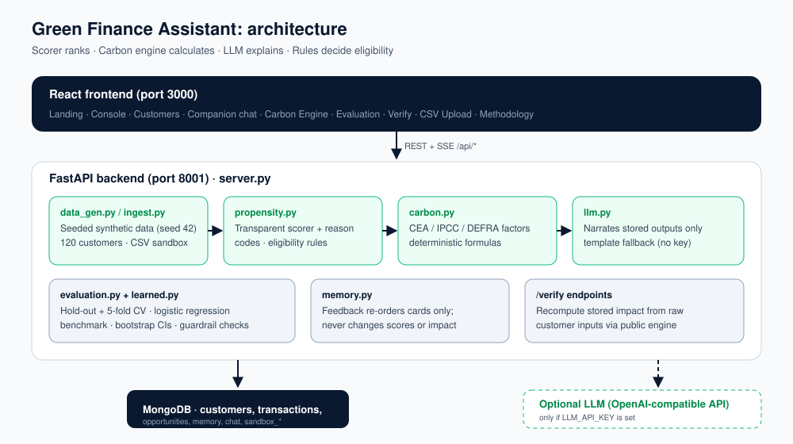

# Green Finance Assistant



## Prerequisites

- Python 3.11+
- Node.js 18+ and Yarn 1.x
- MongoDB 6+ on `localhost:27017`
- Optional: Docker (easiest way to run MongoDB)

## 1. Start MongoDB

With Docker:

```bash
docker run -d --name mongo -p 27017:27017 mongo:7
```

Or with a local install: `mongod --dbpath /path/to/data`.

## 2. Backend

```bash
cd backend
python -m venv .venv
source .venv/bin/activate          # Windows: .venv\Scripts\activate
pip install -r requirements.txt
cp .env.example .env
uvicorn server:app --host 0.0.0.0 --port 8001 --reload
```

The database is seeded automatically on first start (synthetic data, seed 42).

Environment variables (`backend/.env`):

| Variable | Example | Notes |
|---|---|---|
| `MONGO_URL` | `mongodb://localhost:27017` | required |
| `DB_NAME` | `green_finance` | required |
| `CORS_ORIGINS` | `http://localhost:3000` | required, comma-separated list of allowed origins |
| `LLM_API_KEY` | *(empty)* | optional; leave empty to use the deterministic template fallback |
| `LLM_MODEL` | `gpt-4o-mini` | optional; any chat model your provider serves |
| `LLM_BASE_URL` | *(empty)* | optional; any OpenAI-compatible endpoint |

Optional LLM narration (only needed if you set `LLM_API_KEY`):

```bash
pip install -r requirements-llm.txt
```

Without a key every feature still works: explanations and chat use the deterministic fallback.

## 3. Frontend

```bash
cd frontend
cp .env.example .env               # REACT_APP_BACKEND_URL=http://localhost:8001
yarn install
yarn start
```

Open http://localhost:3000. Useful pages: `/console`, `/companion`, `/evaluation`, `/verify`, `/upload`, plus `/legal/terms`, `/legal/privacy`, `/legal/ai` and `/credits`.

## 4. Tests

From the repository root, with the backend venv active (no MongoDB, network or LLM key needed):

```bash
pytest
```

## 5. Regenerate the PDFs (optional)

```bash
pip install reportlab
python scripts/make_m1_pdf.py && python scripts/make_m2_pdf.py
```

## External data

None. All data is synthetic and generated at start-up by `backend/data_gen.py`. No model weights are downloaded.

## Credits

- Backend: [FastAPI](https://fastapi.tiangolo.com), [Uvicorn](https://www.uvicorn.org), [Motor](https://motor.readthedocs.io) / [PyMongo](https://pymongo.readthedocs.io), [Pydantic](https://docs.pydantic.dev), [python-dotenv](https://github.com/theskumar/python-dotenv), [pytest](https://pytest.org)
- Frontend: [React](https://react.dev), [React Router](https://reactrouter.com), [Tailwind CSS](https://tailwindcss.com), [shadcn/ui](https://ui.shadcn.com) and [Radix UI](https://www.radix-ui.com), [Framer Motion](https://www.framer.com/motion/), [Recharts](https://recharts.org), [Lenis](https://lenis.darkroom.engineering), [lucide-react](https://lucide.dev), [Axios](https://axios-http.com), [CRACO](https://craco.js.org)
- PDF generation: [ReportLab](https://www.reportlab.com)
- Fonts: Instrument Serif, Manrope, JetBrains Mono, Plus Jakarta Sans, Outfit (Google Fonts, SIL OFL); photos from [Unsplash](https://unsplash.com/license)
- Emission factors: Central Electricity Authority (India) CO2 baseline database, IPCC 2006 Guidelines, UK DEFRA/DESNZ GHG conversion factors
- LLM: optional narration through the [OpenAI Python SDK](https://github.com/openai/openai-python) (any OpenAI-compatible endpoint)
- AI assistance: parts of the code, UI and documentation were written with the help of AI coding assistants and reviewed by the team

## License

[MIT](LICENSE)
